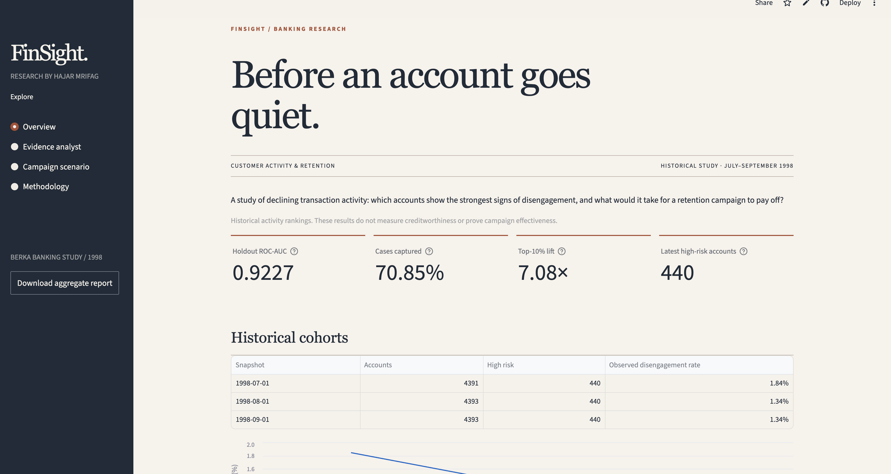

# FinSight AI

[](https://github.com/hajarmrifag/finsight-streamlit/actions/workflows/tests.yml)

### Banking customer disengagement research

Which accounts show signs of declining activity, and when would contacting those customers be worth the cost?

FinSight brings the results of my [churn and reactivation research](https://github.com/hajarmrifag/churn-reactivation-engine) into a Streamlit app. You can explore historical account activity, search the research notes, and test the assumptions behind a retention campaign.

**[Open the live app](https://finsight-ai-hajar.streamlit.app/)** · Built by [Hajar Mrifag](https://github.com/hajarmrifag)



## What you can explore

- **Overview:** model performance, monthly cohorts, and differences in transaction behavior between higher-risk accounts and the rest of the cohort.
- **Evidence analyst:** quick answers about the results and semantic search across the research notes using MiniLM embeddings. Each result includes its source.
- **Campaign scenario:** change the number of contacts, expected save rate, contact cost, and value per save to calculate expected net value and the break-even point.
- **Methodology:** target definition, development and holdout periods, data sources, and validation limitations.

The sidebar also includes a download of the aggregate research results.

## Results

The original model was evaluated on **13,177 held-out account-month observations**, including **199 disengagement cases**.

| Measure | Result |
| --- | ---: |
| ROC-AUC | 0.9227 |
| Average precision | 0.1983 |
| Precision in the top 10% | 10.70% |
| Cases captured in the top 10% | 141 of 199 (70.85%) |
| Top-10% lift | 7.08× |

Ranking the observations by model score puts 141 of the 199 observed cases in the top 1,318 observations. Accounts can appear in more than one month, so these counts refer to account-months, not unique customers.

### Original and purged evaluation

Each target looks 90 days ahead, so the last training snapshots in the original setup have outcome windows that reach into the test period. The purged evaluation removes those training rows before fitting. The two protocols are reported side by side and are never averaged or substituted for each other.

| Locked test | Original | Purged temporal |
| --- | ---: | ---: |
| Training rows | 69,789 | 61,045 |
| Last training snapshot | 1998-06-01 | 1998-04-01 |
| ROC-AUC | 0.9227 | 0.9202 |
| Average precision | 0.1983 | 0.1779 |
| Precision in the top 10% | 10.70% | 10.02% |
| Cases captured in the top 10% | 141 of 199 (70.85%) | 132 of 199 (66.33%) |
| Top-10% lift | 7.08× | 6.63× |

The original values are stored at full precision. The purged values are rounded as published in the [research repository](https://github.com/hajarmrifag/churn-reactivation-engine); the purged result is the more conservative of the two.

## Data and interpretation

The analysis uses the historical [Berka / PKDD 1999 Financial dataset](https://relational.fel.cvut.cz/dataset/Financial). Disengagement means a severe relative decline in customer-initiated transaction activity over the following 90 days. It is not a recorded account closure or credit default.

The app reads saved aggregate results from the research pipeline. It does not train the risk model or score new customers. This repository contains no account-level records or fitted risk model.

The reported metrics reproduce the original model evaluation. A stricter purged temporal robustness check was also run to remove training observations whose 90-day outcome windows crossed into evaluation periods; the purged locked test retained ROC-AUC 0.9202 and top-10% lift 6.63x. Campaign outputs depend on the assumptions entered in the calculator; the research does not measure the effect of a retention intervention.

## Data integrity

`data/research.json` is the only source of model results in the app. It follows a typed schema in `research.py` (published as `data/research.schema.json`), and the app validates it on every load. Validation rejects results that contradict each other, for example a recall that differs from cases captured divided by cases, monthly cohorts that do not add up to the test set, or a purged evaluation whose training outcomes overlap its evaluation period.

The file also holds validation-split outputs (targeting curve, permutation importance, risk-group profile and a candidate model comparison) so that later visualizations have real data to draw. Each block is labeled with its split and protocol, and none of them are test results. The three exported blocks are copied from the research repository by `scripts/import_validation_exports.py`, which can also check that the file is current. This repository never writes to the research repository.

Tests compare the numbers in `data/research.json` with the README tables and the research notes shown in the app.

## Run locally

Use **Python 3.11**.

```sh
git clone https://github.com/hajarmrifag/finsight-streamlit.git
cd finsight-streamlit
python3.11 -m venv .venv
source .venv/bin/activate
python -m pip install -r requirements.txt
python -m streamlit run app.py
```

Semantic search downloads `all-MiniLM-L6-v2` on first use and caches it. If the model cannot load, the app uses word matching and labels the change. The dashboard, campaign calculator, and quick answers work without that download. No API key is required.

## Repository structure

```text
app.py                  Streamlit pages and controls
core.py                 Retrieval and campaign calculations
research.py             Typed schema and consistency rules for the research data
data/research.json      Aggregate model, cohort and validation results
data/research.schema.json  JSON Schema generated from research.py
data/knowledge.json     Research notes and search embeddings
scripts/                Import of validation exports and the visual baseline tool
visual/                 Baseline screenshots and instructions
tests/                  App, research data, and README consistency checks
.streamlit/config.toml  Theme and server settings
requirements.txt        Pinned runtime dependencies
requirements-dev.txt    Test and screenshot tooling
```

Model training and the underlying analysis live in [churn-reactivation-engine](https://github.com/hajarmrifag/churn-reactivation-engine).

## Tests

With the virtual environment active:

```sh
python -m pip install pytest
python -m pytest -q
```

The tests cover page navigation, evidence answers, semantic retrieval, and campaign calculations, including a zero-save scenario. They also validate the research data against its schema and check that the README and the in-app research notes agree with it. The semantic retrieval test needs the MiniLM model available locally or a connection to download it. A session fixture runs the app once before the first test, so the first-load cost of a fresh environment is not counted against any test's timeout.

## Hosting

The live app runs on Streamlit Community Cloud from the `main` branch, with `app.py` as the entry point and Python 3.11 selected in deployment settings.
